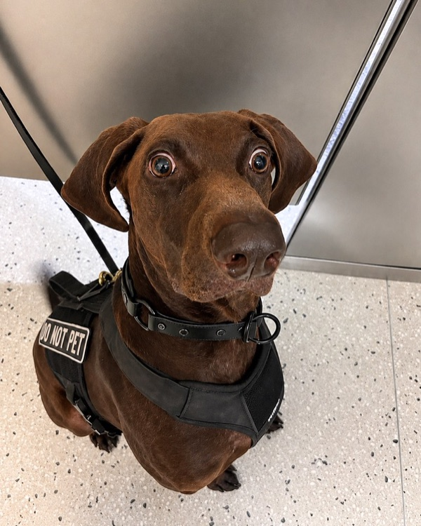
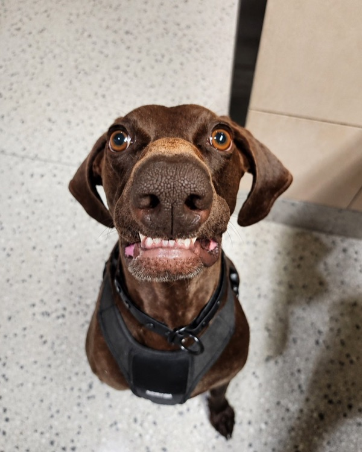
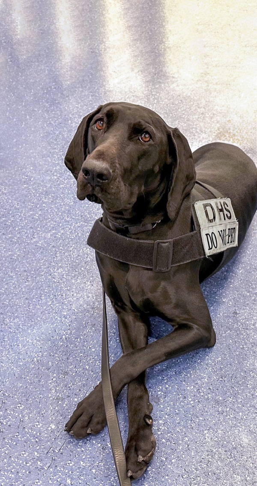
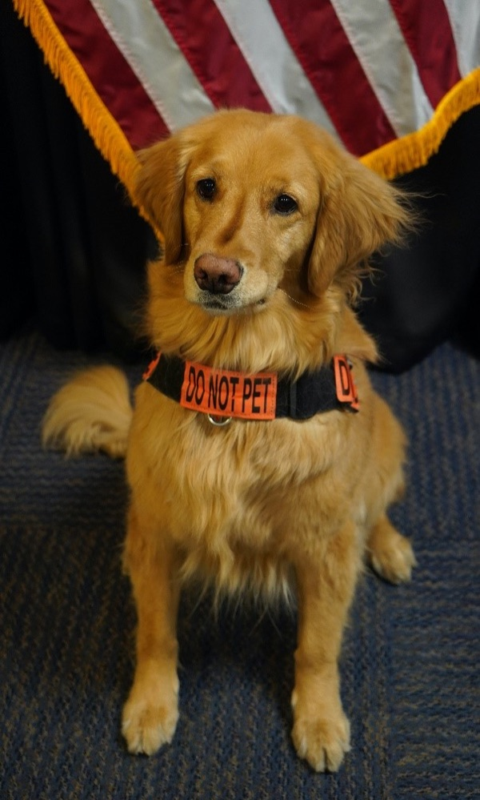
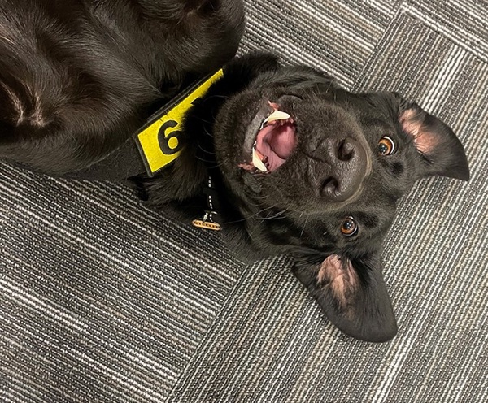
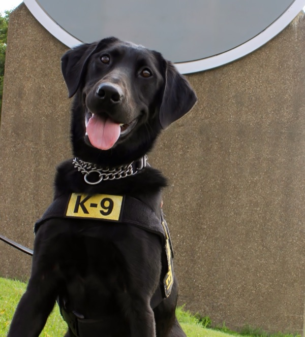

# TSA Bob dog photos

Photos of TSA explosives detection dogs for TSA Bob's PR comments. Each comment shows one, picked at random, 300px wide. The photo is decoration only and says nothing about the verdict.

The files are `assets/tsa-bob-dog-1.jpg` to `assets/tsa-bob-dog-6.jpg`, so a random number from 1 to 6 picks one. Embed it by its raw URL on `main`, with the alt text below:

```html

```

These are the six photos on TSA's Cutest Canine pages that carry a published TSA credit. A photo taken by a US government employee as part of their job has no copyright (17 U.S.C. §105). Each file is the tsa.gov original resized to 600px wide. The full catalog, with the photos we excluded and why, is in the [AI-4729 catalog comment](https://linear.app/alephic/issue/AI-4729/tsa-bob-choose-the-tsa-dog-photos-we-can-reuse-in-verdict-comments).

| # | Photo | Alt text | Credit | Original |
| -- | -- | -- | -- | -- |
| 1 |  | Bolt, a TSA explosives detection dog at Dallas Fort Worth International Airport, sits alert and wide-eyed in his DO NOT PET harness | (TSA DFW photo) | [bolt_1_flickr.jpg](https://www.tsa.gov/sites/default/files/bolt_1_flickr.jpg) on the [2026 winner page](https://www.tsa.gov/news/press/releases/2026/08/26/vote-bolt-dallas-fort-worth-international-airport-named-2026-tsa-top) |
| 2 |  | Bolt, a TSA explosives detection dog at Dallas Fort Worth International Airport, grins ear to ear at the camera | (TSA DFW photo) | [bolt_4_flickr_0.jpg](https://www.tsa.gov/sites/default/files/bolt_4_flickr_0.jpg) on the [2026 winner page](https://www.tsa.gov/news/press/releases/2026/08/26/vote-bolt-dallas-fort-worth-international-airport-named-2026-tsa-top) |
| 3 |  | Dina, a TSA explosives detection dog at Harry Reid International Airport in Las Vegas, lies on duty in her DHS DO NOT PET vest and watches closely | (Photo: Courtesy of TSA) | [2023-cutest-canine_original.jpg](https://www.tsa.gov/sites/default/files/2023-cutest-canine_original.jpg) on the [2023 winner page](https://www.tsa.gov/news/press/releases/2023/08/28/harry-reid-international-airport-canine-dina-voted-tsas-cutest) |
| 4 |  | Alona, a TSA passenger screening dog at the Las Vegas airport, sits at attention in her DO NOT PET vest in front of a US flag | Photo: Courtesy of TSA | [tsa-cutest-canine-2021.jpg](https://www.tsa.gov/sites/default/files/tsa-cutest-canine-2021.jpg) on the [2021 winner page](https://www.tsa.gov/news/press/releases/2021/08/26/tsa-announces-las-vegas-passenger-screening-canine-alona-selected) |
| 5 |  | Steeler, a TSA explosives detection dog at Pittsburgh International Airport, rolls on his back with a big open-mouth grin | (TSA photo) | [steeler_goofy_final_npr_1.jpg](https://www.tsa.gov/sites/default/files/steeler_goofy_final_npr_1.jpg) on the [2025 winner page](https://www.tsa.gov/news/press/releases/2025/08/26/pittsburgh-international-airports-steeler-voted-tsas-top-dog-for) |
| 6 |  | Steeler, a TSA explosives detection dog at Pittsburgh International Airport, smiles with his tongue out in his K-9 vest | (TSA photo) | [steeler_headshot.jpg](https://www.tsa.gov/sites/default/files/steeler_headshot.jpg) on the [2025 winner page](https://www.tsa.gov/news/press/releases/2025/08/26/pittsburgh-international-airports-steeler-voted-tsas-top-dog-for) |
